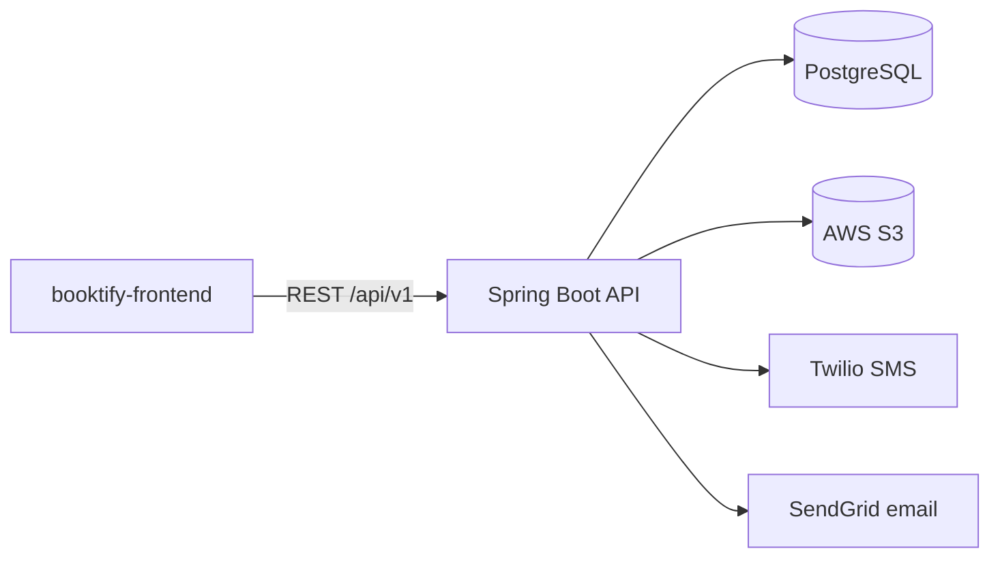

# Booktify Backend

REST API for **Booktify**, an online booking platform for beauty salons. Salon owners create a salon page, invite masters, and publish procedures; masters manage their work schedule; clients pick a master and a free timeslot and get SMS/email confirmations and reminders.

Frontend: [booktify-frontend](https://github.com/qqsucc/booktify-frontend)

    

## Features

- **Auth:** sign-up for clients and masters, two-step sign-in (password or SMS one-time code), JWT access/refresh tokens, role-based access (`CLIENT`, `MASTER`, `ADMIN`)
- **Salons:** create and edit a salon with a public link name, invite masters by email
- **Procedures:** masters publish services with duration and price; available timeslots are computed from the work schedule and existing bookings
- **Appointments:** clients book, masters can book on behalf of clients, update and reschedule
- **Notifications:** SMS via Twilio, email via SendGrid (Velocity templates), scheduled appointment reminders
- **Files:** avatar and image uploads stored in AWS S3
- **Housekeeping:** scheduled cleanup of accounts that never completed activation
- OpenAPI/Swagger UI, Liquibase migrations, Dockerfile and Compose files

## Architecture



The code is organised by feature, each with `controller → facade → service → repository` layers:

```text
src/main/java/org/qqsucc/booktify
├── appointment/    # bookings and reminders
├── procedure/      # services offered + timeslot calculation
├── salon/          # salons, master invitations
├── user/           # auth, clients, masters
├── workschedule/   # masters' working hours
├── file/           # S3 uploads/downloads
├── notification/   # SMS + email orchestration
├── sms/ · email/   # Twilio and SendGrid integrations
└── common/         # security, config, exceptions, scheduler
```

## API overview

Base path: `/api/v1`. Routes under `/public/**` are open; `/private/**` require a `Bearer` access token. Full, interactive docs are served by Swagger UI at **`/swagger-ui.html`** when `props.springdoc.enabled=true` (default in the `local` profile).

| Area | Endpoints |
| --- | --- |
| Auth | `POST /public/users/clients/sign-up`, `POST /public/users/masters/sign-up`, `POST /public/users/sign-in/step-1`, `POST /public/users/sign-in/step-2`, `POST /public/users/refresh-token`, `GET /private/users/me` |
| Salons | `POST /private/salons`, `PUT /private/salons/{salonId}`, `GET /public/salons/{salonLinkName}`, `POST /private/salons/masters/invites` |
| Masters | `GET /public/salons/{salonId}/masters`, `GET /public/salons/{salonId}/masters/{masterId}`, `GET /private/masters/{masterId}/salons` |
| Procedures | `POST/PATCH/DELETE /private/procedures`, `GET /public/masters/{masterId}/procedures`, `GET /public/procedures/{procedureId}/available-timeslots` |
| Work schedule | `GET/PUT /private/masters/work-schedule` |
| Appointments | `GET/POST /private/appointments`, `POST /private/masters/appointments`, `PUT /private/appointments/{id}`, `PUT /private/appointments/{id}/reminders` |
| Files | `POST /private/files`, `GET /public/files/{fileId}`, `PATCH /private/users/avatar` |

Phone numbers are validated as Ukrainian (`380XXXXXXXXX`).

## Configuration

The `local` Spring profile is active by default (Maven profile) and reads these environment variables:

| Variable | Purpose |
| --- | --- |
| `DATABASE-HOST-ENV`, `DATABASE-NAME-ENV`, `DATABASE-USERNAME-ENV`, `DATABASE-PASSWORD-ENV` | PostgreSQL connection (port 5432) |
| `AWS_S3_ACCESS_KEY`, `AWS_S3_SECRET_KEY` | S3 credentials (bucket `booktify`, region `eu-west-1`) |
| `TWILIO_ACCOUNT_SID`, `TWILIO_AUTH_TOKEN`, `SENT_FROM_PHONE` | SMS sending |
| `SENDGRID_API_KEY`, `SENT_FROM_EMAIL` | Email sending |

JWT secrets, token lifetimes, CORS origins and upload limits live in `src/main/resources/application-local.yml`. The JWT secrets there are for local development only — override them for any shared environment.

## Running locally

**Requirements:** Java 17, Docker (for PostgreSQL). The Maven wrapper is included.

```bash
git clone https://github.com/qqsucc/booktify-backend.git
cd booktify-backend

# PostgreSQL on 5432
docker run -d --name booktify-db -p 5432:5432 \
  -e POSTGRES_DB=booktify -e POSTGRES_USER=booktify -e POSTGRES_PASSWORD=booktify \
  postgres:16

# The DB variable names contain hyphens, so pass them with `env` rather than `export`
env 'DATABASE-HOST-ENV=localhost' 'DATABASE-NAME-ENV=booktify' \
    'DATABASE-USERNAME-ENV=booktify' 'DATABASE-PASSWORD-ENV=booktify' \
    AWS_S3_ACCESS_KEY=… AWS_S3_SECRET_KEY=… \
    TWILIO_ACCOUNT_SID=… TWILIO_AUTH_TOKEN=… SENT_FROM_PHONE=… \
    SENDGRID_API_KEY=… SENT_FROM_EMAIL=… \
    ./mvnw spring-boot:run
```

Liquibase creates the schema on startup. The API listens on <http://localhost:8080>, Swagger UI on <http://localhost:8080/swagger-ui.html>. In IntelliJ IDEA you can put the same variables in the run configuration instead.

## Running with Docker

```bash
./mvnw clean package -DskipTests                     # Dockerfile copies target/booktify-*.jar
docker compose -f docker-compose-db.yml up -d         # PostgreSQL + "postgres-net" network
docker compose up --build -d                          # API on :8080, joined to postgres-net
```

Start the database compose file first: it creates the `postgres-net` network the API compose file attaches to. PostgreSQL is published on host port `5434`.

## Tech stack

Spring Boot 3.2 (Web, Security, Data JPA, Validation, Actuator) · PostgreSQL · Liquibase · JJWT · MapStruct · Lombok · Spring Cloud AWS (S3) · Twilio · SendGrid · Apache Velocity · springdoc-openapi · Maven · Docker
